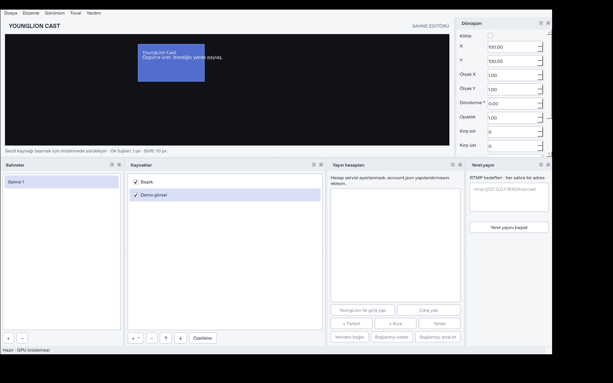

# YoungLion Cast

[](https://github.com/YoungLionOrganization/YoungLionCast/releases)
[](https://github.com/YoungLionOrganization/YoungLionCast/actions/workflows/verify.yml)
[](https://github.com/YoungLionOrganization/YoungLionCast/actions/workflows/native.yml)
[](docs/native.md#build-from-source)
[](COPYING)

YoungLion Cast is an OBS-inspired desktop app for composing scenes and sending video to multiple
receivers. It uses Qt Widgets, C++20 and libobs. Scene editing and local publishing work without
signing in.

[Download the preview](https://github.com/YoungLionOrganization/YoungLionCast/releases) ·
[Quick start](docs/quick-start.md) · [Build from source](docs/native.md#build-from-source)



## What works in the preview

| Feature           | Current support                                                                           |
| ----------------- | ----------------------------------------------------------------------------------------- |
| Scene editing     | Capture sources, text and images, transforms, crop, opacity, undo and saved projects      |
| Desktop UI        | Dockable panels, Turkish interface, light and dark QSS themes                             |
| Multiple outputs  | One H.264 video encoder with independent RTMP connections to up to four local receivers   |
| YoungLion Account | Connect and manage multiple Kick and Twitch publishing authorizations after service setup |

The `v0.3.0` binary preview covers Linux x64. X11 capture and two-receiver RTMP delivery were
verified locally. The native build matrix also targets Windows x64 and macOS on Intel and Apple
Silicon. The local publishing preview carries video over IPv4 loopback. Audio and direct Kick/Twitch
publishing are future work.

## Documentation

| I want to…                                         | Guide                                               |
| -------------------------------------------------- | --------------------------------------------------- |
| Download, open a project or try local RTMP         | [Quick start](docs/quick-start.md)                  |
| Build the desktop app and run tests                | [Desktop development](docs/native.md)               |
| Configure YoungLion Account and Supabase           | [Backend setup](docs/setup.md) · [API](docs/api.md) |
| Understand capture, output and credential handling | [Architecture](docs/architecture.md)                |
| Prepare a build or publish a release               | [Release guide](docs/releases.md)                   |

## Verify and contribute

```sh
npm ci
npm run verify
npm run test:integration   # requires Docker
```

For desktop changes, use the exact Qt **6.12.0** and libobs **33.0.1** SDKs and run the native
tests. Report bugs with the version, OS, desktop session and steps to reproduce. Omit tokens, stream
keys and account cookies.

YoungLion Cast is licensed under [GPL-3.0-or-later](COPYING). See the full [GPL text](LICENSE) and
[third-party notices](third_party/NOTICE.md).
