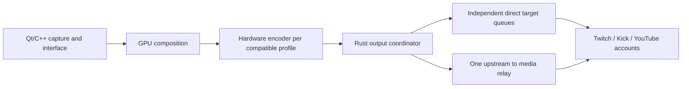

# Architecture and boundaries

The Account authority remains Supabase Auth. Social login identities and third-party publishing
permissions are distinct. An Auth identity trigger and publishing confirmation share an atomic
ownership registry keyed by `(provider, stable provider user ID)`; neither email nor display name
establishes publishing ownership. This registry is private and has no automatic transfer operation.

Publishing OAuth progresses through `started → exchanging → pending → confirmed`, or `failed`. The
start response sets an HttpOnly host-only browser proof outside the authorization URL. A callback
requires that proof, its matching hash and the originating live session before consuming state or
exchanging a provider code. The public API must be first-party/same-site for browser cookie support;
native consumers will open the Account-web linking flow. Credentials are retained as encrypted
pending work immediately after token exchange and before fetching a profile. Only authenticated
owner confirmation exposes connection metadata. Every ciphertext is bound to its immutable
credential UUID, owner and provider with AES-GCM additional authenticated data. Separate key IDs
permit rotation.

The service RPC is invoker-security and executable only by `service_role`. Helpers that read Auth
sessions or coordinate Auth identity creation have fixed empty search paths, live in an unexposed
schema and cannot be called by public users. Only metadata is exposed, read-only under owner RLS.

Credential maintenance uses database leases, conditional versions and consistent metadata-before-
credential lock ordering. Disconnect invalidates a lease immediately. A token rotated by an
already-running worker is checkpointed durably before subsequent provider validation or final
metadata writes; a temporary validation failure therefore retries with the new refresh token. It
cannot reactivate the connection after disconnect; its new token is queued separately for
revocation. Failed network cleanup retains encrypted work with backoff. No database lock is held
while calling Twitch/Kick. See setup for backlog monitoring and integration limitations.

There is no extra Rust OAuth daemon in v1: the chosen Edge Functions approach avoids another service
to operate. The account client is a transport contract for the later native application, not a
web-based replacement for the Qt UI.

## Subsequent native and media phase

Native login will use YoungLion's public OAuth/OIDC client with S256 in the system browser and an OS
credential store. The desktop will not contain a platform client secret or a Supabase secret. The
Account-web PKCE helpers in `clients/account.ts` are for the Account portal integration, not that
future native login implementation.

Compatible outputs share encoded packets. Each target has bounded queues and independent
reconnect/backoff so one congested target does not stall the others. Different codecs, resolutions
or bitrate requirements require additional encoder profiles. Direct upload is approximately the sum
of target bitrates; relay reduces desktop upload but incurs server egress cost. Mode is chosen
before starting a stream. Media never traverses Postgres, Realtime or Edge Functions.

Benchmark against OBS with the same hardware, source and output profile before making performance
claims. CPU/GPU/RAM, frame drops and end-to-end delay are measurement targets, not achieved results.
